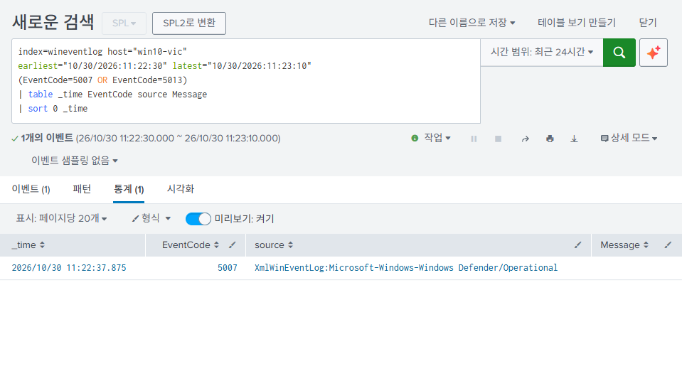
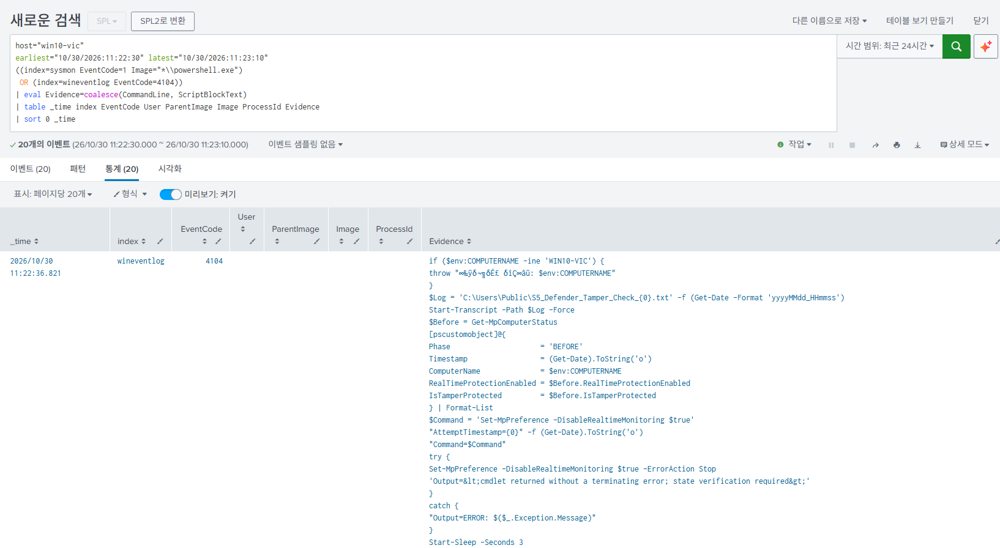
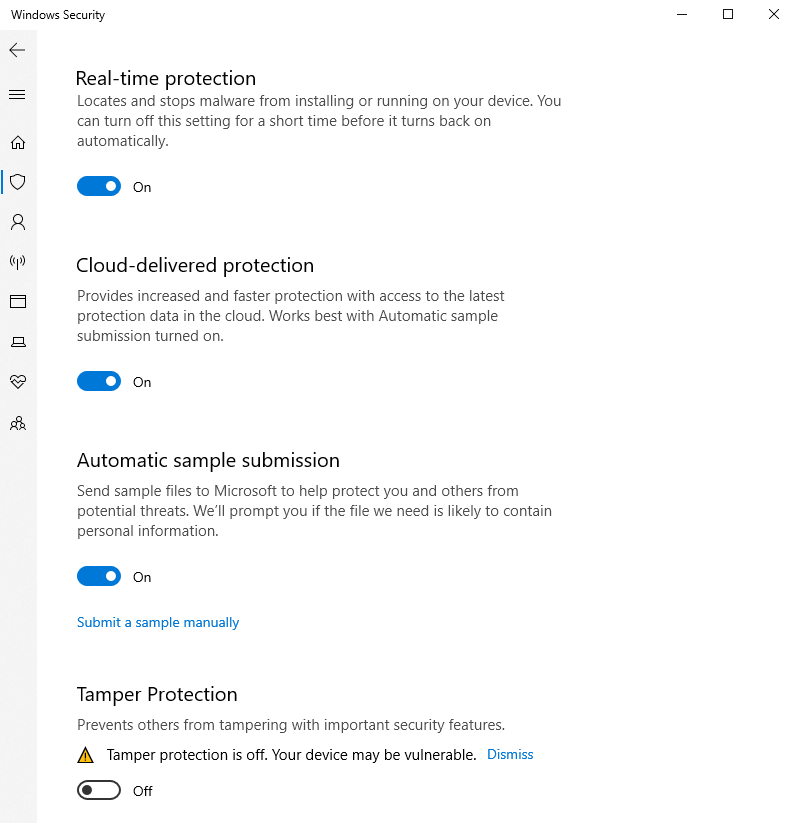
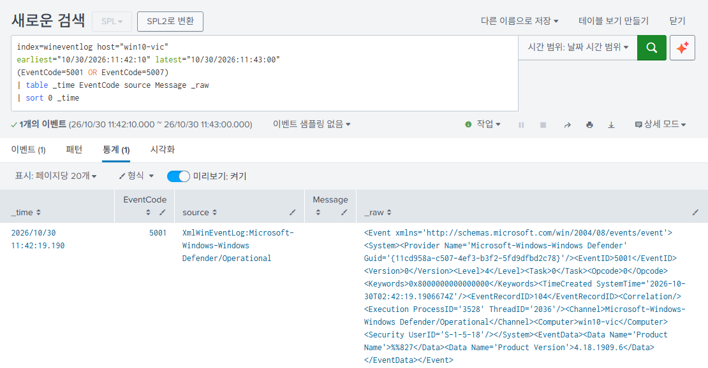
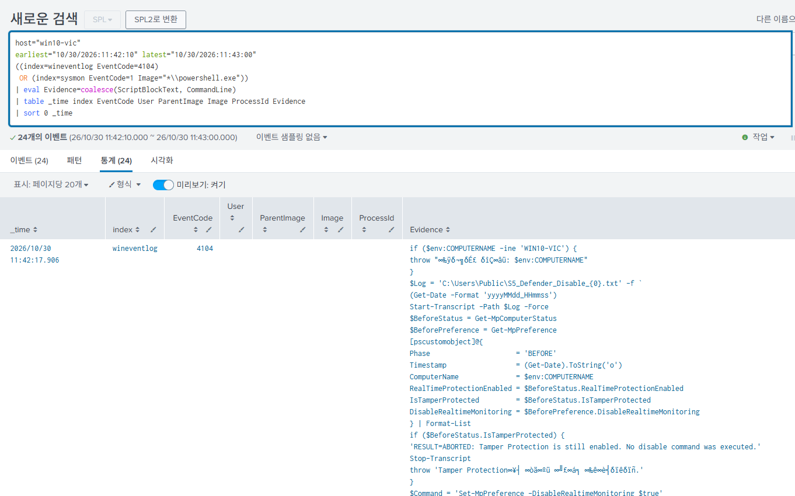
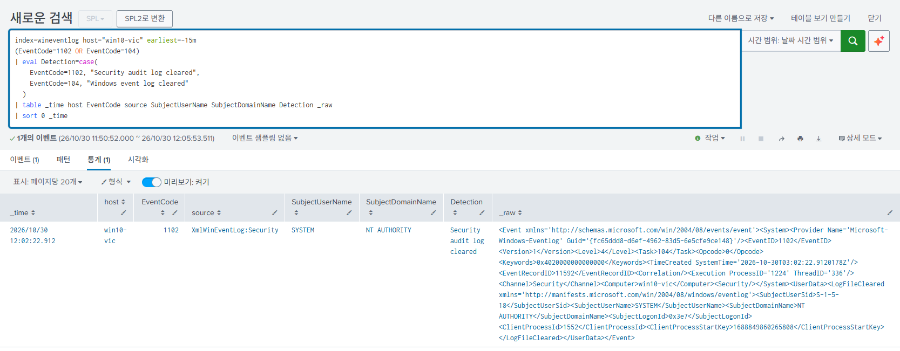

# [실습 보고서] S5. Windows Defender 무력화 및 감사 로그 삭제 탐지 (T1562.001, T1070.001)

## 1. 실습 개요
- **일시:** 2026-10-30
- **대상(Victim):** win10-vic (10.10.10.22)
- **공격자(Attacker):** kali (10.10.10.100)
- **SIEM:** Splunk Enterprise (10.10.10.10)
- **목표:** 시스템 장악 후 수행되는 Windows Defender 실시간 보호 비활성화와 Security 감사 로그 삭제를 재현하고, PowerShell·Defender·Security 로그를 이용해 공격 시도와 성공 여부를 구분하여 탐지한다.

## 2. 실습 과정 및 분석

### [Step 1] Defender 무력화 시도 및 차단 확인

변조 방지(Tamper Protection)와 실시간 보호가 모두 활성화된 상태에서 `SYSTEM` 권한으로 다음 PowerShell 명령을 실행하였다.

```powershell
Set-MpPreference -DisableRealtimeMonitoring $true
```

명령은 종료 오류 없이 반환됐지만 실행 전후 상태는 모두 다음과 같았다.

- `RealTimeProtectionEnabled=True`
- `IsTamperProtected=True`

Defender EID 5007에서 설정 변경 관련 이벤트가 확인됐지만 EID 5013은 발생하지 않았다. 그러나 상태가 바뀌지 않았으므로 무력화 시도는 실패한 것으로 판정하였다. 이 결과를 통해 명령의 정상 반환만으로 성공 여부를 판단할 수 없으며, 반드시 실행 후 보안 상태를 검증해야 한다는 점을 확인하였다.

```splunk
index=wineventlog host="win10-vic"
(EventCode=5007 OR EventCode=5013)
| table _time, host, EventCode, source, Message, _raw
| sort 0 _time
```



*그림 1. 변조 방지가 활성화된 상태에서 Defender 설정 변경 시도와 관련된 EID 5007이 기록되었다.*



*그림 2. PowerShell EID 4104에서 `Set-MpPreference -DisableRealtimeMonitoring $true`가 포함된 실행 스크립트를 확인하였다.*

### [Step 2] Defender 실시간 보호 비활성화 성공

차단 상태와 취약 상태의 차이를 비교하기 위해 변조 방지만 수동으로 해제하고, 실시간 보호는 활성화된 상태에서 같은 명령을 다시 실행하였다.



*그림 3. 실시간 보호는 활성화돼 있지만 변조 방지는 비활성화된 비교 실험 조건이다.*

실행 결과는 다음과 같았다.

| 구분 | 실행 전 | 실행 후 |
|---|---:|---:|
| `RealTimeProtectionEnabled` | `True` | `False` |
| `IsTamperProtected` | `False` | `False` |
| `DisableRealtimeMonitoring` | `False` | `True` |

PowerShell EID 4104에는 `Set-MpPreference -DisableRealtimeMonitoring $true`가 포함된 스크립트가 `2026-10-30 11:42:17.906`에 기록됐고, Defender EID 5001은 `11:42:19.190`에 기록됐다.

**1) Defender 비활성화 결과 탐지**

```splunk
index=wineventlog host="win10-vic"
(EventCode=5001 OR EventCode=5007)
| table _time, host, EventCode, source, Message, _raw
| sort 0 _time
```

Defender Operational의 **EID 5001**은 실시간 보호가 실제로 비활성화됐음을 보여주는 결과 로그이다.

**2) PowerShell 실행 의도 확인**

```splunk
index=wineventlog host="win10-vic" EventCode=4104
| search ScriptBlockText="*Set-MpPreference*DisableRealtimeMonitoring*"
| table _time, host, EventCode, ScriptBlockId, ScriptBlockText
| sort 0 _time
```

EID 4104는 공격자가 실행한 스크립트 내용을 보여주고, EID 5001은 해당 명령 이후 Defender가 실제로 비활성화됐음을 보여준다. 두 이벤트를 같은 호스트와 인접한 시각으로 분석하여 **공격 의도와 실제 결과**를 구분하였다.



*그림 4. Defender Operational EID 5001을 통해 실시간 보호 비활성화 결과를 확인하였다.*



*그림 5. PowerShell EID 4104에 무력화 명령과 실행 전후 상태 확인 코드가 기록되었다.*

### [Step 3] Security 감사 로그 삭제 및 탐지

Defender 보호 기능을 다시 활성화한 후, `SYSTEM` 권한으로 Security 로그 삭제를 재현하였다.

```cmd
wevtutil cl Security
```

Splunk에서 다음 결과를 확인하였다.

- **시각:** 2026-10-30 12:02:22.912
- **이벤트:** Security EID 1102
- **호스트:** `win10-vic`
- **실행 계정:** `NT AUTHORITY\SYSTEM`
- **SID:** `S-1-5-18`
- **로그온 ID:** `0x3e7`
- **ClientProcessId:** `1552`

```splunk
index=wineventlog host="win10-vic"
(EventCode=1102 OR EventCode=104)
| eval Detection=case(
    EventCode=1102, "Security audit log cleared",
    EventCode=104, "Windows event log cleared"
  )
| table _time, host, EventCode, source, SubjectUserName, SubjectDomainName, Detection, _raw
| sort 0 _time
```

이 환경에서는 EID 104 없이 **EID 1102만 확인**되었다. EID 1102는 Security 감사 로그가 실제로 삭제됐음을 직접 나타내므로 로그 삭제 탐지는 성공한 것으로 판정하였다.



*그림 6. Security EID 1102와 `NT AUTHORITY\SYSTEM` 실행 주체를 통해 감사 로그 삭제를 확인하였다.*

### [Step 4] 다중 로그 상관분석

각 이벤트는 서로 다른 질문에 답한다.

| 로그 | 확인 가능한 내용 |
|---|---|
| PowerShell EID 4104 | 어떤 스크립트와 명령이 실행됐는가 |
| Sysmon EID 1 | 어떤 프로세스가 어떤 부모 프로세스와 명령줄로 생성됐는가 |
| Defender EID 5001 | 실시간 보호가 실제로 비활성화됐는가 |
| Defender EID 5007 | Defender 설정 변경이 기록됐는가 |
| Security EID 1102 | Security 감사 로그가 실제로 삭제됐는가 |
| System EID 104 | 특정 이벤트 로그 삭제에 대한 보조 증거 |

다음 쿼리는 같은 호스트와 시간 범위에서 Defender 무력화 및 감사 로그 삭제 관련 이벤트를 하나의 타임라인으로 확인하기 위한 것이다.

```splunk
host="win10-vic"
(
  (index=wineventlog (EventCode=4104 OR EventCode=5001 OR EventCode=5007 OR EventCode=1102 OR EventCode=104))
  OR (index=sysmon EventCode=1)
)
| eval Evidence=case(
    EventCode=4104, ScriptBlockText,
    EventCode=1, CommandLine,
    EventCode=5001, "Defender real-time protection disabled",
    EventCode=5007, "Defender setting changed",
    EventCode=1102, "Security audit log cleared",
    EventCode=104, "Windows event log cleared"
  )
| where EventCode=5001 OR EventCode=5007 OR EventCode=1102 OR EventCode=104
    OR like(lower(Evidence), "%set-mppreference%disablerealtimemonitoring%")
    OR like(lower(Evidence), "%wevtutil%cl%security%")
| table _time, index, EventCode, User, SubjectUserName, ParentImage, Image, ProcessId, ClientProcessId, Evidence
| sort 0 _time
```

상관분석에서 중요한 것은 이벤트를 임의의 순서로 나열하는 것이 아니라, 동일한 `host`와 인접한 `_time`, 프로세스 ID, 계정을 이용하여 **명령 실행 → 보안 상태 변경 또는 로그 삭제 결과**의 관계를 확인하는 것이다.

## 3. 몰랐던 내용 & 새로 알게 된 점

**[기존에 몰랐던 점]**
- **명령 성공과 행위 성공의 차이:** `Set-MpPreference`가 오류 없이 반환돼도 변조 방지가 켜져 있으면 실제 Defender 상태는 바뀌지 않을 수 있었다.
- **이벤트별 역할의 차이:** PowerShell EID 4104는 명령의 의도를 보여주고, Defender EID 5001과 Security EID 1102는 각각 무력화와 로그 삭제의 실제 결과를 보여준다.

**[새로 알게 된 점]**
- **상태 기반 검증:** 보안 설정 변경은 명령 출력만 신뢰하지 않고 실행 전후의 `RealTimeProtectionEnabled`, `IsTamperProtected`, `DisableRealtimeMonitoring` 값을 비교해야 한다.
- **차단 이벤트의 환경 차이:** 이번 Windows 10 환경에서는 변조 방지에 의해 상태가 바뀌지 않았지만 EID 5013은 발생하지 않았다. 따라서 특정 이벤트 하나에만 의존하지 않고 설정 변경 로그와 실제 상태를 함께 확인해야 한다.
- **감사 로그의 외부 전송 필요성:** 로컬 Security 로그가 삭제돼도 삭제 이전에 Splunk로 전달된 이벤트와 새로 생성된 EID 1102는 중앙 SIEM에 남아 분석 근거가 된다.

## 4. 블루팀 관점의 결론

이번 실습에서는 동일한 Defender 비활성화 명령을 보호 상태와 취약 상태에서 각각 실행하여 **차단된 시도와 실제 무력화 성공을 구분**하였다. PowerShell EID 4104에서 공격 명령을 확인하고 Defender EID 5001에서 실시간 보호 비활성화를 입증하였다.

또한 Security 로그 삭제 후 EID 1102를 탐지하여 공격자의 증거 훼손 행위를 식별하였다. 단일 로그만 보는 대신 명령 실행 로그와 결과 로그를 시간·호스트·계정 기준으로 연결하는 것이 방어 회피 행위를 정확하게 분석하는 핵심임을 확인하였다.

---
**[Next Step 예고]**
S3~S5 탐지 결과를 대시보드와 알림 트리아지 자동화에 연결하고, 정상 관리 행위를 기준선으로 분류하여 탐지 룰을 튜닝한다.
